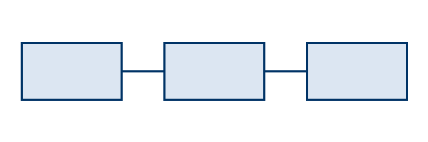

# 표·그림 번호 검증

## 1. 개요

이 문서는 표와 그림 번호가 Word 필드로 들어가는지 확인하는 가상 예시다. 번호를 붙일 표에는 표 사양에 `id`를 주고, 그림에는 그림 줄 끝에 `{#fig-…}`를 단다.

| 구분 | 2025 | 2026 |
|---|---:|---:|
| 매출 | 1,200 | 1,350 |
| 영업이익 | 130 | 150 |

번호를 붙이지 않은 표는 지금과 같이 제목만 나온다.

| 항목 | 내용 |
|---|---|
| 작성 부서 | 문서표준화 TF |
| 검토 상태 | 초안 |

## 2. 구조와 조달

{#fig-structure}

| 조달원 | 금액 | 비중 |
|---|---:|---:|
| 가상은행 | 500 | 62.5% |
| 예시캐피탈 | 300 | 37.5% |
